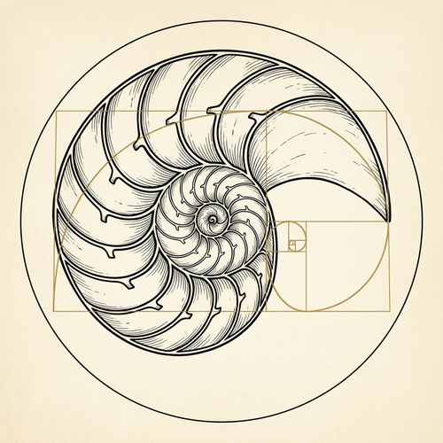

    

<h1 align="center">Nautilio</h1>

*Nautilio* viene de *nautilo*, el molusco que vive dentro de una concha en espiral. Crece
cámara por cámara y, al crecer, conserva su forma: cada vuelta repite la anterior a mayor
escala.

Así trabajamos con los datos públicos: una página a la vez, con permiso, guardando solo lo
que se puede citar. El viaje crece, pero no cambia de forma.

- [nautilio](https://github.com/nautilio/nautilio): la skill que recorre la ciudad de los
  datos y entrega La Cronaca.
